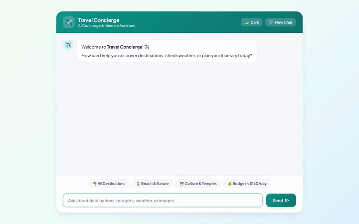

# ✈️ Travel Concierge AI Agent

An intelligent, multi-modal Travel Concierge AI agent built with Google's **Agent Development Kit (ADK)** and deployed to **Vertex AI Agent Runtime**. The agent provides interactive travel planning, itemized budget calculations, destination image and video generation, real-time exchange rates, location geocoding, and cross-session memory.



---

## 🌟 Key Features

* **Multi-Modal Generation**:
  * **Image Generation**: Generates high-quality destination visuals using `gemini-3.1-flash-lite-image`.
  * **Video Generation**: Generates short destination video clips using `gemini-omni-flash-preview` via the Interactions API in the `global` region.
* **Database Catalog & Budget Calculation**:
  * **Firestore Integration**: Queries and manages destination records (daily budget, category, ratings, best seasons).
  * **Itemized Budgeting**: Calculates trip budgets with configurable traveler count, trip duration, and a 15% contingency buffer.
* **Durable Cross-Session Memory**:
  * **Vertex AI Memory Bank**: Remembers user facts, dietary restrictions, and travel preferences across chat sessions using `PreloadMemoryTool` and post-turn callbacks.
* **Geospatial & Currency Utilities**:
  * **Maps & Geocoding**: Converts addresses to geographic coordinates and finds nearby attractions/restaurants via Google Maps API.
  * **Live Exchange Rates**: Fetches live foreign currency exchange rates via Frankfurter API.
* **Rich UI & A2UI Protocol**:
  * Serves structured **A2UI cards** alongside text replies, rendered natively in a custom FastAPI proxy frontend.

---

## 🛠️ Integrated Google Cloud Services & Tools

### Google Cloud Services
* **Vertex AI Agent Runtime (Reasoning Engine)**: Hosts the agent backend on Google Cloud, communicating over the A2A streaming protocol.
* **Vertex AI Memory Bank**: Manages durable long-term memory for user preference persistence.
* **Cloud Storage (GCS)**: Stores generated destination images (`.png`) and videos (`.mp4`) in a public bucket.
* **Cloud Firestore**: NoSQL database holding the travel destination catalog.
* **Agent Engine Sandbox Code Executor**: Provides secure remote python code execution.

### Implemented Agent Tools (`app/agent.py`)
| Tool Function | Description |
| :--- | :--- |
| `PreloadMemoryTool()` | Preloads durable user facts and preferences from Memory Bank on session start. |
| `generate_destination_image` | Generates destination images using `gemini-3.1-flash-lite-image`, saves artifacts, and uploads to GCS. |
| `generate_destination_video` | Generates short destination videos using `gemini-omni-flash-preview`, saves artifacts, and uploads to GCS. |
| `list_destinations` | Queries Firestore catalog filtered by category and daily budget limit. |
| `get_destination` | Retrieves detailed destination information and highlights from Firestore. |
| `add_destination` | Adds or updates destination documents in Firestore. |
| `calculate_trip_budget` | Computes itemized travel estimates based on daily rates from Firestore. |
| `get_currency_exchange_rates` | Fetches real-time foreign currency exchange rates. |
| `geocode_address` | Converts addresses and landmarks to latitude/longitude using Google Maps Geocoding API. |
| `find_nearby_places` | Finds nearby restaurants and attractions using Google Maps Places API (New). |
| `get_weather` | Retrieves location weather updates. |

---

## 🎨 Web Frontend Features

The project includes a FastAPI A2A proxy (`frontend/main.py`) and a single-page chat interface (`frontend/static/index.html`):
* **Theme Switcher**: Light/Dark mode toggle with persistent state.
* **Category Filter Chips**: Instant prompt filters for Beaches, Culture, Budget, and All Destinations.
* **Lightbox Preview Modal**: Clickable full-screen viewer for generated destination images.
* **Session Reset Button**: Reset context ID and clear chat history for new conversations.
* **Animated Typing Indicator**: Bouncing dot animation during tool execution.

---

## 🚀 Setup & Local Execution

### Prerequisites
* Python 3.11+
* `uv` package manager
* `gcloud` CLI authenticated with a Google Cloud Project

### 1. Install Dependencies
```bash
# Install agent dependencies
uv sync

# Install frontend dependencies
cd frontend
pip install -r requirements.txt
cd ..
```

### 2. Run the Agent Locally
```bash
# Start local ADK web interface
uv run adk web app
```

### 3. Run the Frontend Proxy Locally
```bash
cd frontend
export AGENT_ENGINE_RESOURCE_NAME="projects/<PROJECT_NUMBER>/locations/us-east1/reasoningEngines/<ENGINE_ID>"
export AGENT_DIRECTORY="app"

uvicorn main:app --host 0.0.0.0 --port 8080
```
Open your browser to port 8080 to interact with the Travel Concierge frontend.

---

## 📦 Deployment Instructions

### Deploy Agent to Vertex AI Agent Runtime
```bash
agents-cli deploy --project <YOUR_PROJECT_ID> --no-confirm-project
```

### Deploy Frontend to Cloud Run
```bash
cd frontend
gcloud run deploy travel-concierge-frontend \
  --source . \
  --region us-east1 \
  --allow-unauthenticated \
  --set-env-vars "AGENT_ENGINE_RESOURCE_NAME=projects/<PROJECT_NUMBER>/locations/us-east1/reasoningEngines/<ENGINE_ID>,AGENT_DIRECTORY=app"
```
